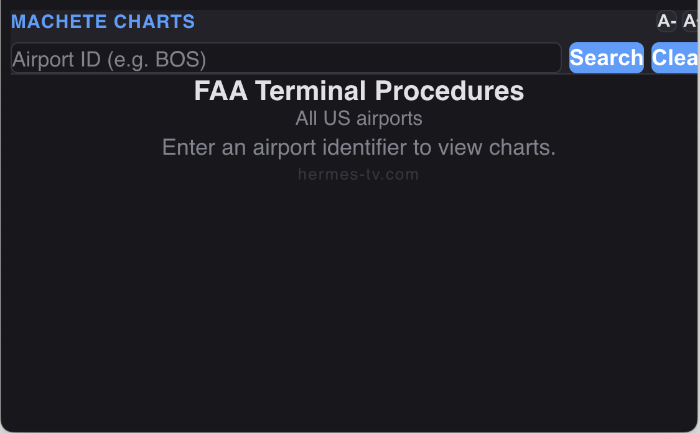

# Machete Charts

Free airport charts inside Microsoft Flight Simulator. View airport diagrams, instrument approaches, SIDs, and STARs without leaving the cockpit.



## Why Machete Charts

- **Free** — no subscription, no account, no API key.
- **Official data** — charts come straight from government AIPs (FAA d-TPP and European eAIPs), not third-party re-draws.
- **Current** — refreshed every 28-day AIRAC cycle, so procedures match real-world publication.
- **In the cockpit** — opens as an MSFS toolbar panel; no alt-tabbing or second screen.
- **VR friendly** — on-screen keyboard support, scalable text, and touch/pinch zoom.
- **Light on your system** — charts are loaded on demand rather than bundled, so the install stays small.
- **MSFS 2020 and 2024** — the installer detects every Community folder and installs to all of them.

## What Works

- Search by ICAO/FAA code or airport name with suggestions
- Four chart categories per airport: diagrams, approaches, departures (SIDs), and STARs
- Zoom, pan, double-click quick zoom, and Fit to reset
- Invert button for dark-mode viewing
- Adjustable text size (up to 300%), saved between sessions
- Close button in the panel header

## Supported Charts

Machete Charts gives you access to **3,800+ airports across 21 countries**, sourced from official government Aeronautical Information Publications (AIPs). Charts are updated every 28 days to match the AIRAC cycle.

- **Airport Diagrams** — Taxi layouts
- **Instrument Approaches** — ILS, RNAV, VOR, LOC, and visual approaches
- **Departures (SIDs)** — Standard instrument departure procedures
- **STARs** — Standard terminal arrival routes

### Countries

| Country | Airports | Source |
|---------|----------|--------|
| United States | 3,185 | FAA d-TPP |
| France | 132 | SIA eAIP |
| UK | 114 | NATS |
| Spain | 59 | ENAIRE |
| Germany | 58 | DFS BasicIFR |
| Norway | 52 | Avinor |
| Sweden | 45 | LFV |
| Thailand | 42 | CAAT |
| Denmark | 28 | Naviair |
| Finland | 24 | ANS Finland |
| Austria | 21 | Austro Control |
| Portugal | 19 | NAV Portugal |
| Netherlands | 17 | LVNL |
| Poland | 15 | PANSA |
| Iceland | 14 | Isavia |
| Czech Republic | 11 | ANS CR |
| Ireland | 9 | AirNav Ireland |
| Estonia | 8 | EANS |
| Hungary | 8 | HungaroControl |
| Belgium | 7 | skeyes |
| Singapore | 4 | CAAS |
| Hong Kong | 2 | CAD |

Airport counts are the airports that have published charts in each country's current AIP.

### Not Yet Available

- **Italy** — ENAV requires a registered login; the scraper is not implemented yet.

## Install

### Installer (Recommended)

Download **MacheteChartsSetup.exe** from the [latest release](https://github.com/tmhoule/MacheteCharts/releases) and run it. The installer auto-detects your MSFS Community folders — if you have both MSFS 2020 and 2024 installed, it will install to both automatically.

### Manual Install

1. Download or clone this repo
2. Copy the `machete-charts` folder into your MSFS Community folder:
   - **MS Store 2024:** `%LOCALAPPDATA%\Packages\Microsoft.Limitless_8wekyb3d8bbwe\LocalCache\Packages\Community\`
   - **MS Store 2020:** `%LOCALAPPDATA%\Packages\Microsoft.FlightSimulator_8wekyb3d8bbwe\LocalCache\Packages\Community\`
   - **Steam:** `%APPDATA%\Microsoft Flight Simulator\Packages\Community\`
3. Restart MSFS

### PowerShell

```powershell
powershell -ExecutionPolicy Bypass -File installer\install.ps1
```

Or double-click `installer\install.bat`.

## How to Use

1. Open the toolbar at the top of the screen in MSFS
2. Click the **Machete Charts** icon
3. Type an airport code (e.g. `BOS`, `LFPG`, `EGLL`) or name and select from suggestions
4. Pick a chart category — Diagram, Approaches, Departures, or STARs
5. Select a plate to view it

### Navigation

- **Zoom:** Scroll wheel, pinch, or +/- buttons
- **Pan:** Click and drag
- **Quick zoom:** Double-click an area
- **Reset view:** Click **Fit**
- **New search:** Click **Clear**

### VR Tips

- Tap the search input to bring up the on-screen keyboard
- Use **^** / **v** to scroll suggestions, **Go** to select
- Use **A-** / **A+** to adjust text size (up to 300%)
- Your text size preference is saved between sessions

## Uninstall

Run `installer\uninstall.ps1` or delete the `machete-charts` folder from your MSFS Community folder.

## Requirements

- Microsoft Flight Simulator 2020 (v1.19.8+) or 2024
- Internet connection (charts are loaded on demand)

## Credits

Built by [hermes-tv.com](https://hermes-tv.com). US charts from the FAA's digital Terminal Procedures Publication (public domain). European charts from freely accessible government AIPs; copyright remains with the respective national aviation authorities.

## License

This project is provided as-is for flight simulation use.
